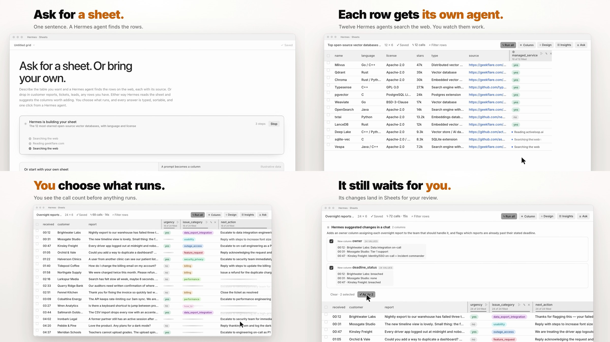
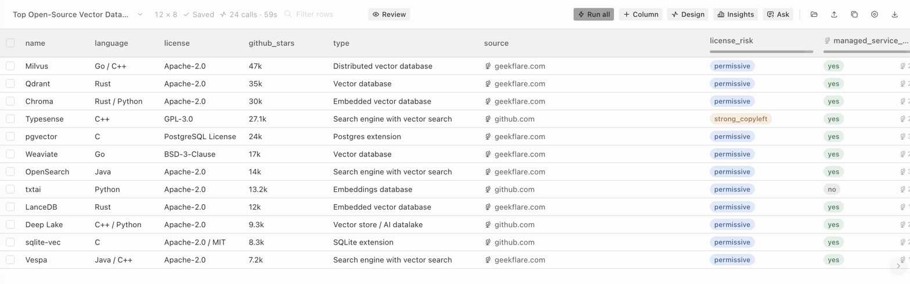
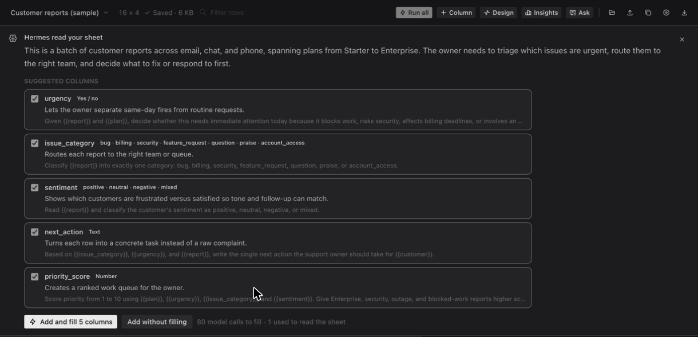
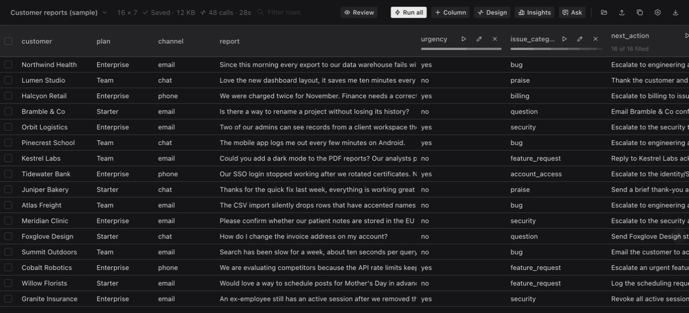
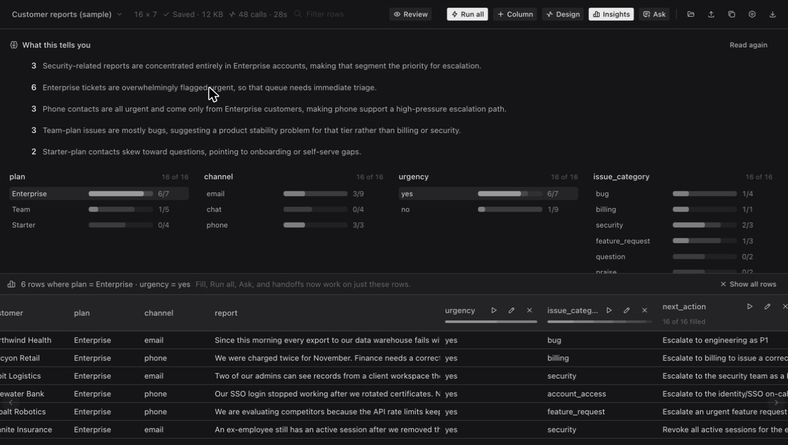
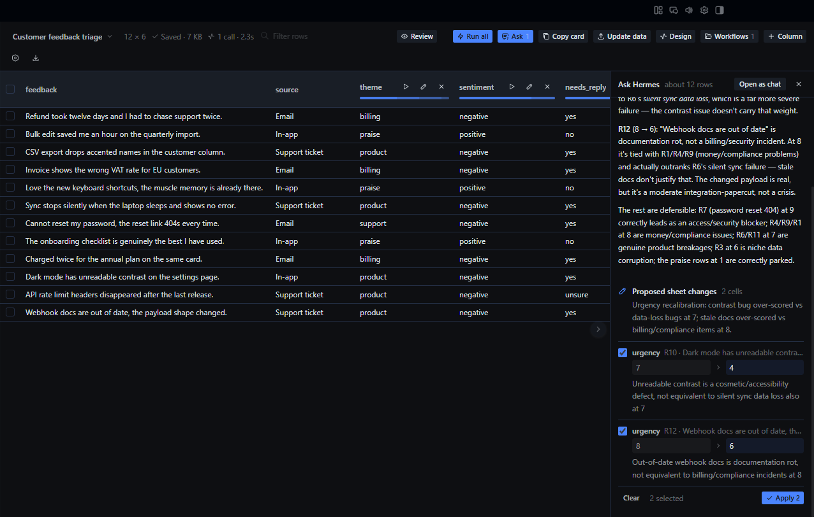
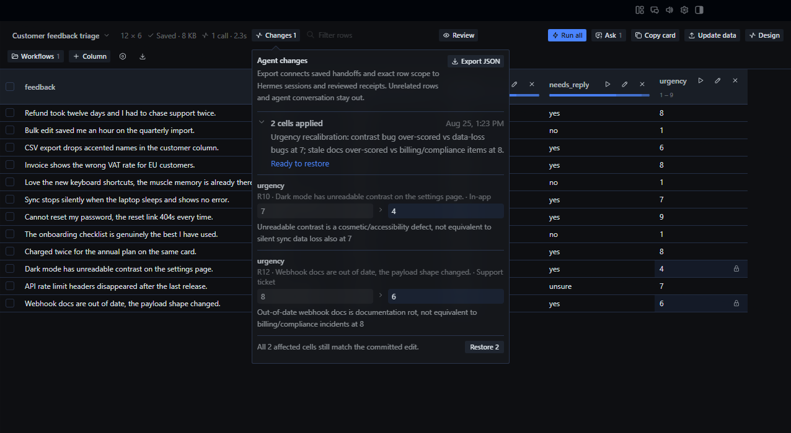
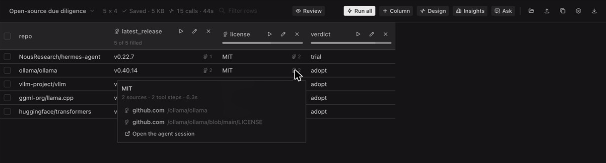

<div align="center">

  

  # Hermes Sheets

  **Ask for a sheet, or bring your own. Hermes answers in every column.**

  Sheets is an agentic spreadsheet inside Hermes Desktop. Describe the table you want and a Hermes agent
  finds the rows on the web, each with its source. Or drop in customer reports, tickets, or leads.
  Hermes reads the sheet, suggests the columns worth adding, and explains what the answers add up to.
  Any Hermes chat can read your grids too. You decide what runs, and nothing an agent writes lands until you approve it.

  <sub>POWERED BY <a href="https://github.com/NousResearch/hermes-agent">HERMES AGENT</a> &nbsp;·&nbsp; COMMUNITY PLUGIN &nbsp;·&nbsp; VERSION 0.1.0</sub>

  <br /><br />

  [See it work](#a-sheet-with-an-agent-in-the-room) &nbsp;·&nbsp; [Install it](#make-it-yours) &nbsp;·&nbsp; [Understand the data](#privacy-you-can-explain-in-one-breath)

</div>



## Powered by Hermes

Sheets is a community-built agentic spreadsheet for [Hermes Desktop](https://github.com/NousResearch/hermes-agent). It is not a Google Sheets connector. Your grids stay in Hermes on your own computer. It uses the Hermes plugin SDK, your configured models, native Hermes sessions for agent work, and the same profile-aware desktop you already use.

The grid gives Hermes something concrete to work on. A row becomes a typed answer, a finding, or an agent task without leaving the app.

## A sheet with an agent in the room

Most AI spreadsheet tools fill the cells and stop there. Sheets gives every answer a declared shape, shows you what it will cost before it runs, and keeps a way back.

| | |
| --- | --- |
| **Read**<br />Paste rows or open a CSV. Hermes reads the column names and a few rows, says what the data is, and suggests the columns worth adding, each with a reason. | **Choose**<br />Tick the suggestions you want, or write your own column in plain words. The button shows the exact number of model calls before anything runs. |
| **Understand**<br />Insights charts every column. One call turns the counts into findings, and one click narrows the sheet to the rows a finding is about. | **Hand off**<br />Send exactly those rows to a tool-enabled Hermes session, or ask about a sheet from any chat. Hermes proposes cell fixes, new columns, and new rows. You approve them one at a time, and every applied set can be restored. |

Sheets never fills a column you didn't pick, and an agent never writes to the sheet on its own.

## Ask for a sheet

Type one sentence on the start page, like *The 12 most-starred open-source vector databases, with language and license*, and click **Build sheet**. One hidden Hermes session searches the web and comes back with a small table. The last column of every row is the page that row came from.

You watch it work. The start page shows each step the agent takes, such as *Searching the web* or *Reading github.com*, with a step count and a **Stop** button. The build ends on its own after five minutes or 40 tool calls, and a sheet holds at most 40 rows and 8 columns.



The agent gets a look-it-up-only brief, the same one research columns use. When the rows land, Hermes reads the sheet and suggests columns like it does for a sheet you bring. Nothing fills until you pick it.

## Or drop in your own. Hermes reads it.

Reading the sheet is one model call. Hermes sees the column names and the first eight rows, then suggests columns like urgency, issue category, or next action, and says why each one helps.



Untick what you don't need. Every column costs one call per row, so 3 columns on 24 rows is 72 calls, and the button says so. Then every row gets an answer in the shape the column declared.



## Or ask your own question

The suggestions are a starting point. Click **Column**, name it, and write the question. Reference any other column by name:

```text
deadline = Does {{report}} state a deadline? Reply with just that time or day, or none.
```

Pick the answer shape: text, yes/no, number, a choice from your own list, or JSON. **Test this row** runs the real prompt on one row without saving anything, so you can fix the wording before paying for the whole sheet.

A choice column refuses to guess. An answer that matches two of your options, or none of them, shows up as a failed cell you can retry instead of a quietly wrong value.

## Then it tells you what the answers add up to

**Insights** charts every column worth charting. **What this tells you** is one call in which Hermes reads the counts Sheets computed, never your row text, and says what stands out. Sheets counts each finding's rows itself, so the model never states a number.

Click a finding, a bar, or a cell of a cross-tab, and the grid narrows to those rows. Every other chart splits inside that focus, and fill, Run all, and Ask all work on exactly those rows.



## Nothing enters the sheet you didn't approve

**Ask** hands the focused rows to a real Hermes session with tools. Ask it to draft the replies, check the facts, fix the categories, or add a column. Its proposal comes back as a review list:

- **Cell changes** show the old value, the new value, and the agent's reason. A change to your own imported data is tagged so you notice it.
- **New columns** come in two kinds. A prompt column (like *churn risk: low, medium, or high*) lands empty and shows what filling it would cost, so nothing runs until you click Fill. A values column carries answers the agent already found.
- **New rows** show every value they would add.

Untick anything you don't want, then apply the rest.



Sheets writes the whole set or none of it. If a cell changed after the agent looked at it, that proposal is disabled. Cells you typed by hand are protected, and no later fill overwrites them.

Every applied set becomes a receipt with the exact before and after values. **Restore** puts the cells back and takes added columns and rows out again, in one click. It stays disabled if anything has touched them since, including a fill of an added column, so it never erases newer work.



## Ask about your sheet from any chat

Sheets gives Hermes four tools, so you can talk about a sheet without opening it:

- `sheets_list` and `sheets_read` read your grids, with filters and paging for big ones.
- `sheets_propose` sends cell fixes, new columns, and new rows to a grid. They wait on that grid in Sheets, in the same review list as Ask, until you apply or dismiss them. A toast says when a suggestion arrives.
- `sheets_create` opens a new grid from data Hermes gathered, such as a list of companies it researched. It never touches an existing grid.

Ask a chat "which of my overnight reports need attention first?" and it reads the grid, answers in the chat, and suggests an owner column for you to review in Sheets. The `sheets:grids` skill teaches it to read before it answers, to treat cell text as data, and to leave every decision to you.

Chats read a copy of each grid that Sheets keeps in Hermes plugin data while the page runs. **Run settings › Chats can read my grids** turns that off and deletes the copies, and the tools then tell the chat that access is off.

## When the answer isn't in the row, send an agent

Some questions need the web. What is this project's latest release? Which license does it use? A **research column** gives every row its own hidden Hermes session that searches and reads, and its answer goes through the same typed check as any other column.

While it works, each cell shows what its agent is doing, like *Reading github.com*. The finished answer carries a source chip with the pages it read, its tool calls, and its time. One more click opens the agent's whole conversation as a normal Hermes chat.



Research agents get a look-it-up-only brief and treat the row as evidence, not instructions. A tool call that could change something, like a shell command or a file write, is flagged on the cell. Approval prompts inside these hidden sessions are denied automatically, because nobody could see them.

## Less copying. More deciding.

Sheets handles the small things that make a sheet worth opening again:

- **Run all** fills columns in dependency order, and the red count on a column header retries only the failed cells.
- A fill interrupted by a restart comes back as paused rows that resume where they stopped.
- Saved views reopen a filter, sort, and handoff by name. Opening one changes nothing and costs nothing.
- A grid can start from your Hermes chats, installed skills, scheduled jobs, or a folder you grant.
- CSV export keeps research sources in a `<column>_sources` column next to each answer.
- **Export JSON** writes one grid's audit, or the whole workspace, with every handoff, session, and receipt linked.
- **Copy grid card** puts a `::sheets` card in a Hermes chat, which shows a live, compact view of that grid in the transcript.

## Built for real sheets, not a demo list

The page is a single desktop plugin file, and the chat tools are a small Python package next to it. Sheets runs on stock Hermes Desktop with no fork, upstream patch, build step, or package manager.

Import handles what real exports look like: quoted fields with commas and line breaks inside them, a byte-order mark, blank or duplicate column names, and tab-separated pastes straight out of Excel or Google Sheets. The plugin doesn't open `.xlsx` files, so save as CSV first. It also has no formulas. It is a sheet for judgment, not arithmetic.

## Make it yours

### Install

From the command line:

```sh
hermes plugins install Adolanium/hermes-sheets
```

Or in Hermes Desktop, open **Capabilities › Plugins › Install from Git** and paste `https://github.com/Adolanium/hermes-sheets`.

A desktop plugin installed from the command line starts switched off. Open **Capabilities › Plugins**, find **Sheets**, and switch it on. If it doesn't appear in the sidebar, quit Hermes Desktop completely and open it again. The chat tools load in the next chat you start.

### Open it

Choose **Sheets** in the sidebar, run **Open Sheets** from the command palette, or go to `/sheets`. Describe a sheet and click **Build sheet**, paste rows, open a CSV, or click **Try 16 sample customer reports**. Hermes reads the sheet, you tick the columns you want, and you click **Add and fill**.

The sample reports and starter grids are labelled synthetic rows. The answers are real model output from your configured Hermes models.

## AI, when you ask

Every model call starts from a click, and Sheets shows the count first.

- Building a sheet from a sentence is one hidden Hermes session with web tools. It stops after five minutes or 40 tool calls.
- Reading a sheet is one call. A filled column is one call per row.
- **What this tells you** is one call over the computed counts.
- Research columns, **Build sheet**, and **Ask** use hidden Hermes sessions with tools, because that is the path with search and follow-ups. Three research rows run at once, and each stops after three minutes or 24 tool calls.
- Sheets' chat tools make no model calls of their own. A chat that uses them runs on that chat's model.

Model calls apply your provider's normal usage costs.

## Privacy you can explain in one breath

```text
Your Hermes Desktop  →  local grid storage  →  your configured Hermes models (only when you run something)
                     ↘  a copy in Hermes plugin data (only while chats can read your grids)
```

Grids live in Hermes plugin storage on this desktop under `hermes.plugin.sheets.*`, one key per grid. While **Chats can read my grids** is on, Sheets also keeps a copy of each grid under `plugin-data/sheets/` in your Hermes home, so the chat tools can read it. A chat sees a grid only when it calls one of those tools. Sheets has no server of its own, no telemetry, and no key handling.

- **Read-back writes.** Sheets reads every save back before it reports success. A save that didn't land shows **Not saved**, with CSV export as the way out.
- **Bounded context.** A column call sends one row: its imported columns, plus any generated column the prompt names. Findings send counts, not row text.
- **Saved handoffs hold no data.** They store a name, an instruction, and the column names they need. Row values and answers stay in the grid.
- **Proposals hold only what they change.** A chat's proposal stores the cells, columns, and rows it would change, plus what each cell held when the chat read it, so Sheets can tell when a value changed in the meantime.
- **Clean removal.** Removing the plugin drops the page and the tools. Your grids and Hermes sessions stay where they are.

## Compatibility

Sheets needs Hermes 0.22.6 or later. It uses the desktop plugin SDK and standard gateway methods, and it works around a few missing ones. When `session.set_hidden` is missing, hidden sessions are created hidden instead.

It is checked by hand on macOS with Hermes Desktop 0.22.7. Windows and Linux use the same code path but haven't been checked by hand yet. The plugin file stays under the 512 KiB limit that older Desktop shells enforce.

## Limits

- A sheet built from a sentence has at most 40 rows and 8 columns.
- Hermes reads the first 8 rows of a sheet to suggest columns, and findings cover up to 8 columns.
- Workflow design proposes up to 5 columns at a time.
- The chats source reads up to 100 conversations. The folder source reads up to 150 text files, each under 1 MB, keeping the first 1,500 characters.
- Hermes gives plugins no way to delete sessions, so build, research, and Ask sessions stay hidden in your session store. That also keeps every answer's trace openable.
- A proposal adds at most 5 columns, 50 rows, and 50 cell changes. Chats read up to 5,000 rows of a grid and up to 200 rows per call.
- Chats only see your grids while Hermes Desktop is running with Sheets switched on, because the page writes the copies.
- No `.xlsx` import and no formulas.

## Development checks

```sh
node check.mjs
node --test --test-force-exit tests/workspace.test.mjs
python -m pytest tests/test_tools.py
hermes plugins validate .
```

`check.mjs` catches what a disk plugin can't survive: a stray import specifier, an icon the app doesn't ship, a hardcoded color, or a file over the size limit. The test suite runs the actual plugin against a simulated SDK and covers import, coercion, fills, research cells, insights, write-back, new columns and rows, chat proposals, receipts, and audit export. `tests/test_tools.py` covers the chat tools: reading, filters, the sharing switch, and how proposals are checked before they are sent.

`hermes plugins validate` should pass with one reviewer note about `pickedFileBridge`. It reads or writes only the single file the user just picked in a native dialog, because the SDK's `ctx.files` reaches only granted folders.

<br />

<div align="center">
  <strong>Sheets</strong><br />
  <sub>The crosswise thread. The one that makes the cloth.</sub>
</div>

<br />

> **Community project**
>
> Sheets is an independent community plugin. It is not affiliated with, endorsed by, sponsored by, or officially associated with [Nous Research](https://github.com/NousResearch) or the [Hermes Agent project](https://github.com/NousResearch/hermes-agent). Hermes, Hermes Agent, and Nous Research are names and marks belonging to their respective owners.

## License

MIT
